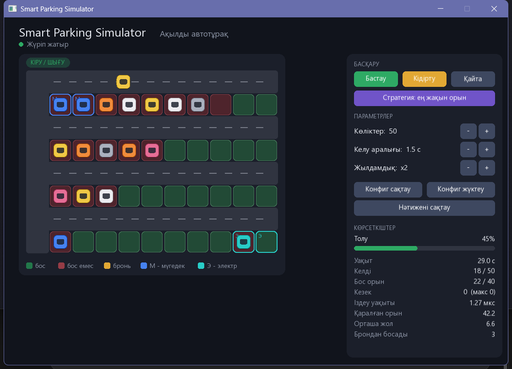

# Smart Parking Simulator — Ақылды автотұрақ

Тұраққа кіретін көліктерге орын бөлуді және олардың қозғалысын модельдейтін C++17 бағдарламасы. Интерфейс — SFML 3.

**▶ Телефоннан ашу (браузер нұсқасы):** https://agerusha.github.io/smart-parking/
**📄 Есеп:** [docs/report.md](docs/report.md) · **UML:** [docs/uml.md](docs/uml.md)



## Мүмкіндіктер

- Көліктің кіруі, орынға жүруі (анимация), тұруы және шығуы
- Бос орын картасы: жасыл — бос, қызыл — бос емес, сары — брондалған
- Арнайы орындар: **М** — мүгедектерге (кіреберіске ең жақын), **Э** — электрокөліктерге
- Брондау: басында 3 кездейсоқ орын брондалады; картадағы бос орынды басса да брондалады. Мерзімі өткенде орын автоматты түрде босайды
- Орын болмаса көлік кезекке тұрады (`std::queue`)
- Екі стратегия: **ең жақын орын** және **жүктемені теңестіру**
- Конфигурацияны `config.txt` файлына сақтау/жүктеу, нәтижені `results.txt` файлына сақтау

## Жинау (Windows, Visual Studio 2022/2026)

Visual Studio-да **"Desktop development with C++"** және оның ішіндегі vcpkg болуы керек.

1. Visual Studio → **Open → Folder** → `SmartParking` бумасын ашу. VS `CMakeLists.txt` пен `vcpkg.json` файлын өзі танып, SFML-ді жүктейді (алғашқы рет 5–10 минут).
2. Іске қосу нысаны ретінде `parking.exe` таңдау.

Немесе командалық жолдан (**x64 Native Tools Command Prompt**):

```bat
cmake -B build -S . -G Ninja -DCMAKE_BUILD_TYPE=Release -DCMAKE_TOOLCHAIN_FILE="%VCPKG_ROOT%\scripts\buildsystems\vcpkg.cmake"
cmake --build build
build\parking.exe
```

SFML табылмаса, `tests` пен `bench` бәрібір жиналады (оларға SFML керек емес).

## Басқару

| Батырма | Әрекеті |
|---|---|
| Бастау / Кідірту | Симуляцияны жүргізу / тоқтату |
| Қайта бастау | Сол параметрлермен басынан бастау |
| Стратегия | ең жақын ↔ теңестіру (симуляция қайта басталады) |
| Көліктер − / + | 20 → 50 → 100 |
| Келу аралығы − / + | 0.5 … 5 с |
| Жылдамдық − / + | x1 … x16 |
| Конфиг сақтау / жүктеу | `config.txt` |
| Нәтижені сақтау | `results.txt` |
| Картадағы бос орынға басу | Орынды брондау |

## Конфигурация файлы

```
rows=4
cols=10
cars=50
interval=1.5
stayMin=30
stayMax=90
reserved=3
reserveTime=20
seed=42
strategy=nearest
```

Жарамсыз мән болса (мысалы `cars=abc`, `cars=-5`, белгісіз кілт) бағдарлама қате хабарын көрсетеді және ескі параметрлер сақталады.

## Тесттер мен өлшеу

```bat
build\tests.exe   # 6 тест: бастапқы шарт, күтілетін және нақты нәтиже
build\bench.exe   # 20/50/100 көлік × 2 стратегия, results.csv жазады
```

Нәтижелер мен талдау: [docs/report.md](docs/report.md). UML: [docs/uml.md](docs/uml.md).

## Файлдар

| Файл | Мазмұны |
|---|---|
| `src/Car.*` | Көлік: түрі, күйі, маршрут бойымен қозғалыс |
| `src/ParkingSpot.*` | Бір орын: түрі, күйі, брондау мерзімі |
| `src/ParkingLot.*` | Орындар торы, қашықтық, маршрут, аймақтар |
| `src/Strategy.*` | Абстрактілі стратегия және екі іске асыруы |
| `src/Config.*` | Параметрлер, тексеру, файлға сақтау/жүктеу |
| `src/Simulation.*` | Уақыт, келу, кезек, статистика |
| `src/main.cpp` | SFML интерфейсі |
| `tests/tests.cpp` | Тесттер |
| `tests/bench.cpp` | Сценарийлерді өлшеу |

## Топ мүшелерінің үлесі

| Мүше | Жұмысы |
|---|---|
| _Аты-жөні 1_ | `Car`, `ParkingSpot`, `ParkingLot`, UML |
| _Аты-жөні 2_ | `Strategy` (екі алгоритм), `Simulation`, өлшеу |
| _Аты-жөні 3_ | SFML интерфейсі, `Config`, тесттер, есеп |
