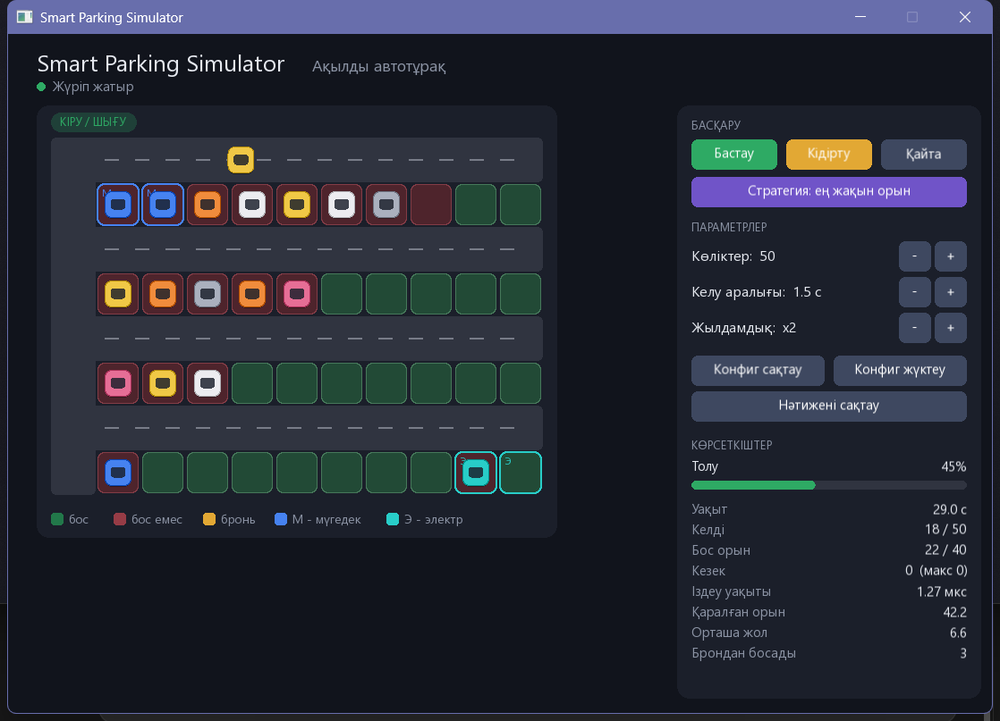

# Smart Parking Simulator — қысқаша есеп

## 1. Мақсаты

Тұраққа кіретін көліктерге орын бөлу және қозғалысты модельдеу; екі орын іздеу стратегиясын бірдей шартта салыстыру.

## 2. Құрылымы

Негізгі кластар (толығырақ — [uml.md](uml.md)):

- **Car** — көлік: түрі (қарапайым, мүгедек, электр), күйі (кезекте → жүріп келеді → тұр → шығып барады → кетті), маршрут бойымен қозғалыс.
- **ParkingSpot** — бір орын: түрі, күйі (бос / бос емес / брондалған), брондау мерзімі. Бос емес орынға тұруға тырысса `std::logic_error` лақтырады.
- **ParkingLot** — орындар торы (`std::vector`), кіреберістен қашықтық, маршрут, 3 аймақ бойынша толу пайызы, мерзімі өткен броньдарды босату.
- **Strategy** (абстрактілі) → **NearestStrategy**, **BalancedStrategy** — мұрагерлік мұнда орынды: екі алгоритмнің интерфейсі бірдей, симуляция қайсысы екенін білмейді (`std::unique_ptr<Strategy>`).
- **Config** — параметрлер, тексеру, файлға сақтау/жүктеу.
- **Simulation** — уақыт қадамы, келу кестесі, кезек (`std::queue`), статистика.
- **App** (`main.cpp`) — SFML терезесі, батырмалар, карта.

SFML таңдалды, себебі есепке қарапайым 2D тор мен анимация жеткілікті, ал Qt үлкен әрі күрделірек.

## 3. Алгоритмдер

Екі алгоритм де өз кодымызда жазылған (кітапхана функциясы қолданылмаған), іздеу — сызықтық, O(n).

**Ең жақын орын.** Барлық орынды аралап, бос қарапайым орындардың ішінен кіреберістен жол ұзындығы ең кішісін таңдайды. Жол ұзындығы: `2·қатар + (баған + 1) + 1`.

**Жүктемені теңестіру.** 1) Әр аймақтағы бос емес орын үлесін санайды; 2) бос орны бар, ең аз толған аймақты таңдайды; 3) сол аймақтағы ең жақын бос орынды алады.

Екеуінде де мүгедек/электр көлігі алдымен өз түріндегі арнайы орынды іздейді, ол бос болмаса қарапайым орынға тұрады. Қарапайым көлік арнайы орынға тұрмайды.

## 4. Тесттер

`build\tests.exe` нәтижесі — 6/6 өтті.

| № | Түрі | Бастапқы шарт | Күтілетін | Нақты |
|---|---|---|---|---|
| 1 | Қалыпты | 4×10 бос тұрақ, қарапайым көлік (0,1 — мүгедек орындары) | орын 2 | орын 2 ✔ |
| 2 | Қалыпты | 2×9 тұрақ, 2-орын бос емес | nearest=9, balanced=3 | nearest=9, balanced=3 ✔ |
| 3 | Қалыпты | 4×10, 20 көлік, seed=42, соңына дейін | 20 тұрды, 20 кетті, кезек 0, 40 бос | сондай ✔ |
| 4 | Шеткі | 1×6 тұрақ толы; 6 орынға 20 көлік | екі стратегия да −1, кезек > 0 | сондай ✔ |
| 5 | Шеткі (брондау) | 3-орын t=10 с дейін брондалған | t=9.9 — әлі брондалған, t=10 — босады | сондай ✔ |
| 6 | Қате енгізу | `cars=abc`, `cars=-5`, белгісіз кілт, қате стратегия; бос емес орынға екінші көлік | 5 жағдайда да қате ұсталады | 5 қате ✔ |

## 5. Өлшеу нәтижелері

Бірдей бастапқы шарт: тұрақ 4×10 (40 орын), орташа келу аралығы 1.5 с, тұру уақыты 30–90 с, басында 3 орын 20 с-қа брондалған, `seed=42` (екі стратегияда келу кестесі бірдей). `build\bench.exe`:

| Көлік | Стратегия | Іздеу уақыты, мкс | Қаралған орын | Орташа жол | Макс. кезек | Орт. кезек | Макс. толу, % | Орт. толу, % | Аймақ айырмасы, % |
|---|---|---|---|---|---|---|---|---|---|
| 20 | ең жақын | 0.44 | 42.0 | 6.85 | 0 | 0.00 | 50 | 26.9 | 28.3 |
| 20 | теңестіру | 0.61 | 53.4 | 7.60 | 0 | 0.00 | 50 | 26.9 | 11.3 |
| 50 | ең жақын | 0.36 | 44.0 | 8.64 | 0 | 0.00 | 95 | 43.9 | 24.7 |
| 50 | теңестіру | 0.62 | 56.4 | 8.90 | 0 | 0.00 | 95 | 44.0 | 12.9 |
| 100 | ең жақын | 0.32 | 42.8 | 9.07 | 9 | 1.12 | 100 | 61.4 | 22.0 |
| 100 | теңестіру | 0.49 | 55.2 | 9.19 | 8 | 1.15 | 100 | 62.6 | 13.8 |

*Аймақ айырмасы* — ең көп және ең аз толған аймақ толуының айырмасы (уақыт бойынша орташа).
Іздеу уақыты наносекундтық деңгейде, сондықтан әр іске қосқанда сәл өзгереді; тұрақты көрсеткіш — қаралған орын саны.

## 6. Талдау

- **Іздеу уақыты.** Теңестіру ~1.3 есе көп орын қарайды (аймақтарды санау + аймақ ішінде іздеу), сондықтан баяуырақ. 40 орында екеуі де 1 мкс-тан аз — практикада айырма жоқ.
- **Жүктеме.** Теңестіру аймақтар арасындағы айырманы 2 есеге жуық азайтады (28% → 11%, 20 көлік). Ең жақын стратегия кіреберіс жақтағы орындарды бірінші толтырады.
- **Жол ұзындығы.** Теңестіруде көлік сәл алысырақ жүреді (6.85 → 7.60) — бұл біркелкі жүктеменің «бағасы».
- **Кезек.** 20 және 50 көлікте кезек болмайды. 100 көлікте тұрақ 100% толады, кезек 8–9 көлікке жетеді. Кезекке стратегия әсер етпейді — оны орын саны мен келу/кету жылдамдығы анықтайды.
- **Брондау.** Барлық сценарийде 3 брондалған орын 20 с өткен соң автоматты түрде босады (тест 5 және бағдарламадағы «Брондан босады: 3»).

**Қорытынды:** жүргізушінің жолы мен іздеу жылдамдығы маңызды болса — ең жақын орын; тұрақтың біркелкі тозуы / аймақтардағы кептеліс маңызды болса — теңестіру стратегиясы жақсы.
